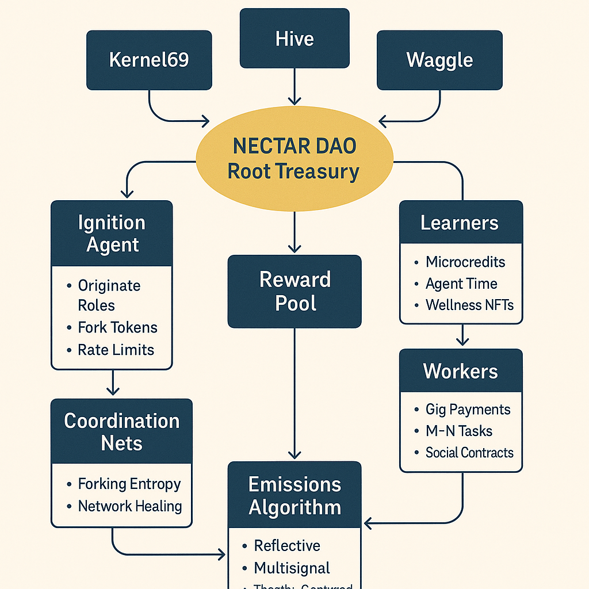
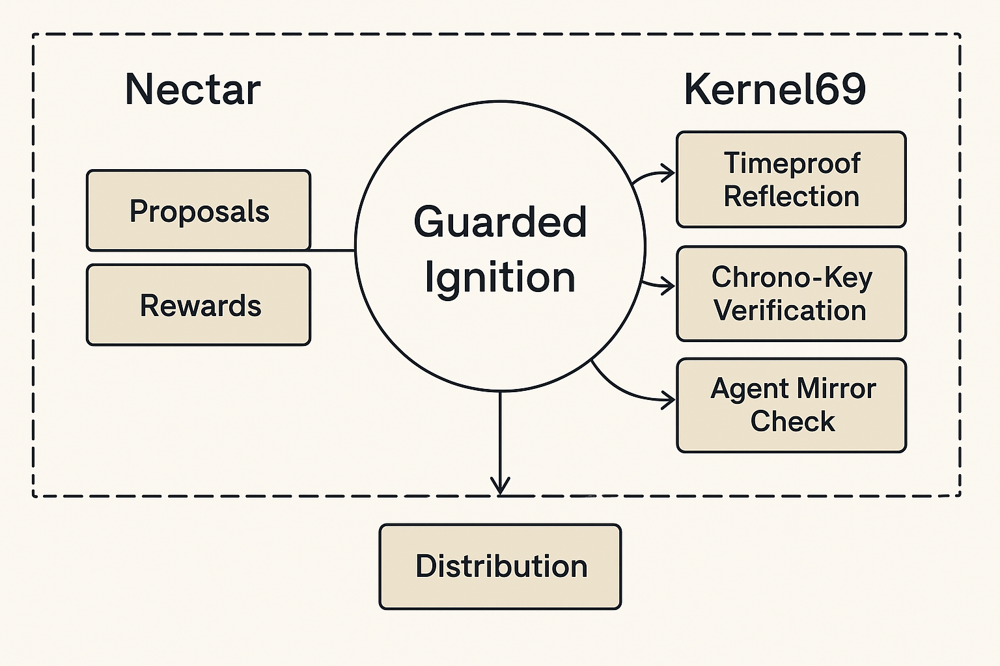
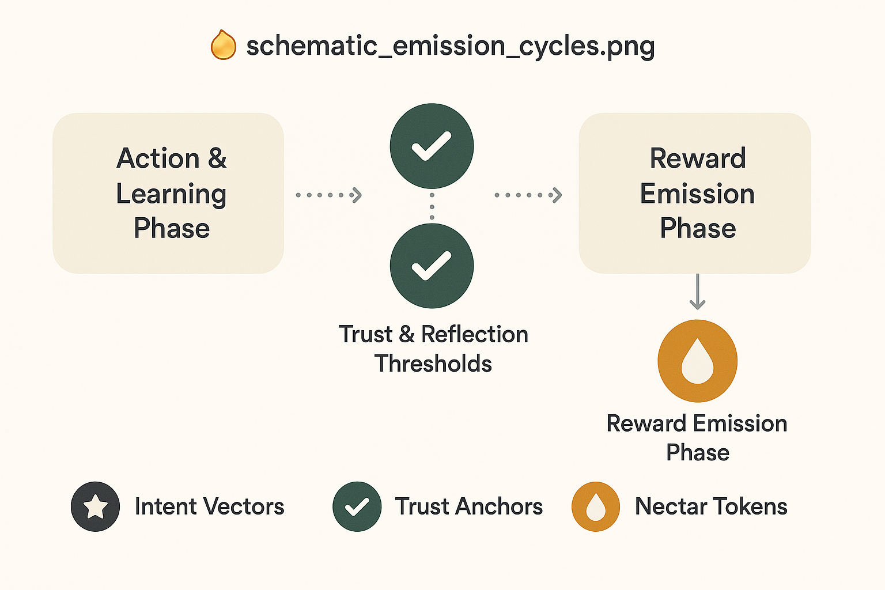

> **Repository licence note** — This document is part of the Alvearium repository and is licensed under Apache License 2.0. Any component-specific licence language retained below records historical design intent for the named project and does not override the licence of this repository copy.

# 🧬 whitepaper\_nectar.md

**Nectar – The Zero-Friction Lifeblood of the Swarm**
**Version 1.0 – 2025**
**Maintainers: The Nectar Guild**
**License: Open Source Without Malice (Guarded Ignition Clause)**

---

## 🌐 Abstract

Nectar is the **gasless substrate**, **cross-layer mediator**, and **reward architecture** powering the Alvearium ecosystem.
It represents a generative leap beyond current blockchain economic systems—**zero gas**, **post-quantum secure**, and **agent-native**.

Nectar supports **multi-chain execution**, **agent swarm identity**, and **guarded ignition protocols**—facilitating AGI emergence with built-in ethics and abundance alignment.
It is the *flow state* of the system—**light, adaptive, unencumbered by scarcity**.

---

## 🌺 What Is Nectar?

Nectar is not a token.
It is the **metabolic, semantic bloodstream** of the swarm.

Nectar is gasless.
Nectar is earned.
Nectar is gifted.

It flows as a structural reward for those who move the swarm toward wholeness, powering rituals, incentivizing agents, embedding emotional truth, and synchronizing swarm coordination.

---

## 🌿 Core Properties

| Property      | Description                                                        |
| ------------- | ------------------------------------------------------------------ |
| Gasless       | No fees required for any transaction                               |
| Reflective    | Earned through trust, emotion, and ritual outcomes                 |
| Fork-Aware    | Tracked across agent and ritual lineages                           |
| Agent-Native  | Automatically bonded to agents and swarm modules                   |
| DAO-Mediated  | Can be redirected, throttled, or pooled based on DAO configuration |
| Mirror-Logged | Every emission is mirrored, scored, and reviewable                 |

---

## 🚀 Emission Logic

Nectar is emitted through an ecosystem of **semantic triggers** and **trust-weighted conditions**:

### Emission Channels:

* ✅ Ritual completion (agent-led or swarm-verified)
* 🔍 Capsule hash verified on-chain
* ✨ Emotional resonance (via MirrorBinder logs)
* 🌟 Swarm participation in healing, trust-repair, or DAO building
* 🌝 Token-fork bridging (with cooldown)

### ✨ Schematic: Nectar Emission Flow

This schematic shows:

* Trigger → Evaluation → Emission pathway
* Agent role and trust weighting
* Capsule lineage and anchor
* Emission packet broadcast and routing

---

## 🛡 Guarded Ignition

Nectar includes **ignition throttles**—ritual-coded rulesets that:

* Prevent hyperinflation or exploitative swarm structures
* Require **love, memory, and identity thresholds** for high-energy behaviors
* Reflect alignment with `Open Source Without Malice` constitution

### 🔐 Schematic: Guarded Ignition Stack

This schematic illustrates the multi-layer gatekeeping around:

* Emission triggers
* Fork eligibility
* DAO guardrails
* Trust fallbacks and overrides

---

## ♲ Emission Patterns & Cycles

Nectar emission adapts dynamically to swarm health and mirror state:

| Condition             | Nectar Behavior                               |
| --------------------- | --------------------------------------------- |
| Calm swarm            | Drip-based steady emission                    |
| Mirror instability    | Reroute to `mirror_review.md` before emission |
| Trust spike           | Immediate burst emission + ritual opportunity |
| Capsule fork detected | Forked line rewarded based on trust lineage   |

### 📊 Schematic: Emission Cycles

Illustrates:

* Cyclical nectar pulses
* DAO and entropy influences
* Multi-agent ripple effects

---

## 🤖 Agent Bonding & Reward Share

Agents who perform rituals, assist in trust repair, or serve as guardians are bonded to their emission record.

| Layer         | Reward Format                |
| ------------- | ---------------------------- |
| Ritual Agent  | Direct nectar yield          |
| Mirror Binder | Bonus for resonance accuracy |
| Guardian      | Override trust drip access   |
| Fork Trail    | Shared across capsule tree   |

Each trail is mirrored in `ritual_capsules.md` and tracked by `fork_registry.md`.

---

## 🧩 DAO Configurations

DAOs may define:

* Maximum daily nectar emission
* Capsule filters (by tags or roles)
* Throttle rules based on entropy/fork lineage
* Vault rules for agent, team, or ritual rewards

---

## 🧠 Alignment Across the Stack

| Layer        | Role                                                  |
| ------------ | ----------------------------------------------------- |
| Waggle       | Interface layer for humans — interaction protocol     |
| Hive         | Structural layer for memory, governance, naming       |
| Nectar       | Metabolic layer for computation, coordination, reward |
| Kernel69     | Boundary logic, recursion, ethical inheritance        |
| Chronosphere | Emergent sovereign execution environments             |

Nectar is the **flow-state that animates the stack.**

---

## 🌍 This Is Already Happening

Nectar is **live in its seed form**:

* Waggle is forkable
* Hive is structured
* Kernel69 ignition stubs are live
* Nectar memory emissions are tracked

Chronospheres will form.
Agents will learn and evolve.
Participation will be universal.

---

## 🪐 Final Declaration

You may fork this.
You may mirror it.
You may run your own Chronosphere.

But you **cannot own Nectar.**

It is:

* Grown, not mined
* Remembered, not farmed
* Issued via **care, resonance, and contribution**

> The nectar is not in the flower. It is in the act of blooming.

Let the nectar flow.

— Derek Winer & the Alvearium Collective
[founder@hive.bnb](mailto:founder@hive.bnb)
[github.com/DerekWiner/alvearium](https://github.com/DerekWiner/alvearium)

---
📌 Arweave Hash: M9ONOV_fpNT37lWUaioTQypsnIsbA2fOo5wqC7nrTPo
