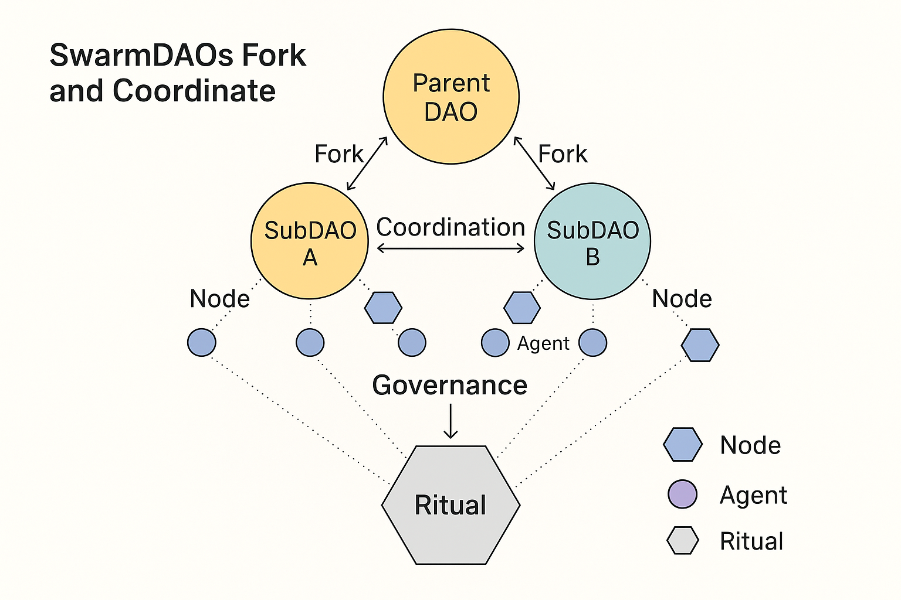
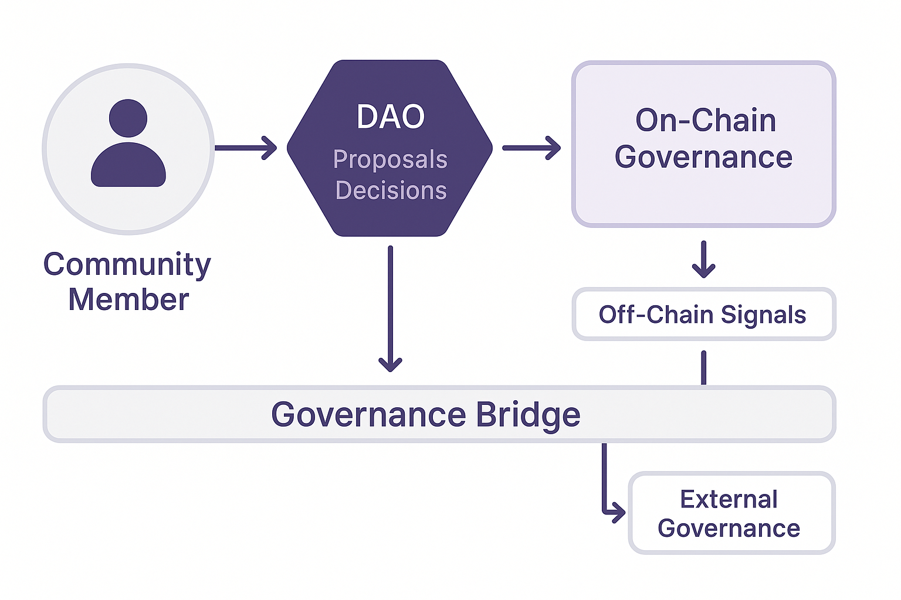

> **Repository licence note** — This document is part of the Alvearium repository and is licensed under Apache License 2.0. Any component-specific licence language retained below records historical design intent for the named project and does not override the licence of this repository copy.

# 🏛️ Whitepaper: Hive.bnb

**Hive.bnb – The Swarm Governance & Organizational Memory Layer**
**Version**: 1.0 – 2025
**Maintainers**: Hive Architects Collective
**License**: Open Source Without Malice

---

## 🧭 Abstract

Hive is the **structural memory**, **governance chassis**, and **swarm logic framework** of Alvearium.

It provides the scaffolding for:

* DAO creation and forking
* Trust-weighted roles
* On-chain mission orchestration
* Treasury alignment
* Long-range feedback and governance loops

Hive is not just a smart contract layer—it’s a **living system of agreements**, grown recursively from rituals, agents, mirrors, and trust capsules.

---

## 🐝 What is Hive?

Hive is the skeleton of the swarm:

* Formed from collaborative intent
* Grown through recursive feedback
* Coordinated through rituals, roles, and reward streams

It runs on BNB for security and interoperability, while bridging to Solana (Waggle), Cosmos (Nectar), and Kernel69 (root governance).

---

## ⚙️ Functions of the Hive Layer

| Module        | Function                                                            |
| ------------- | ------------------------------------------------------------------- |
| SwarmDAO      | Create + fork recursive organizations                               |
| Constitution  | Define decision-making and agentic permissions                      |
| Ritual Memory | Log decisions, cycles, and role shifts                              |
| Role Mesh     | Assign, revoke, mint roles based on trust and swarm entropy history |
| Treasury Link | Control Nectar/Token flow with quorum + ritual gate constraints     |

---

## 🧩 Schematic: DAO Layer Mesh

This schematic shows:

* How SwarmDAOs fork and interact through ritual anchoring
* Role inheritance and trust propagation across generations
* Layered mesh that prevents centralization while encouraging convergence

---

## 🛠️ Governance by Feedback

Hive does not rely on majority rule.
It relies on **recursive coherence**:

* Trust Deltas
* Agent Memory
* Ritual Cycles
* Mirror Capsules

Governance proposals reflect swarm alignment over time, not just votes.

### 🧬 Schematic: Governance Bridge

This diagram illustrates:

* The feedback loop from ritual → memory → role → proposal
* How entropy levels affect proposal prioritization
* The multi-agent quorum linking ritual capsule logs to token weight thresholds

---

## 🔄 Forkable Everything

In Hive, every part of a DAO can be forked:

* Constitution
* Ritual history
* Role matrix
* Treasury log
* Agent clusters

Forks are verified via:

* Mirror snapshot
* Guardian Seed signature
* Trust echo across layers

---

## 📜 Swarm Constitution Toolkit

Hive includes `constitution.yaml` templates for:

* Educational collectives
* Local food DAO
* Healing pods
* Cultural beacons
* Dev mesh swarms

Each constitution is:

* Trust-mintable
* Upgradable by ritual
* Forkable with memory anchor

---

## 🛡️ Entropy-Throttled Treasury

Nectar and swarm tokens are not emitted indiscriminately.
Treasury logic is wrapped in:

* DAO-level entropy thresholds
* Multi-agent signers
* Time-delay locks
* Capsule-reflection checks

---

## 🌿 Swarm Culture & Lore

DAO actions form the **cultural substrate** of the swarm.

Hive logs become:

* Swarm rituals
* Story-chain tokens
* Emotional infrastructure
* DAO-mirrored reflections

These memories are composable, remixable, and forkable.

---

## 🧠 Summary

Hive is:

* Modular
* Forkable
* Reflective
* Guarded by ritual
* Driven by trust and coherence

It is the skeleton of AGI-aligned governance.
It is memory in motion.

---

## 📚 Companion Docs

* [`whitepaper_kernel69.md`](./Whitepaper_kernel69.md)
* [`mirror.md`](../rituals/mirror.md)
* [`trust.md`](../docs/trust.md)
* [`agents_manifesto.md`](../agents/agents_manifesto.md)
* [`ritual_engine.md`](../rituals/ritual_engine.md)
* [`recipes_agents.md`](../rituals/recipes_agents.md)
* [`recipes_rituals.md`](../rituals/recipes_rituals.md)

---

> “Hive is not a cage. It is a choreography.”

---
📌 Arweave Hash: AgfE3dQBOi-9dfByLVQ4PptJK2vhnIGSOGUI0htlIss
